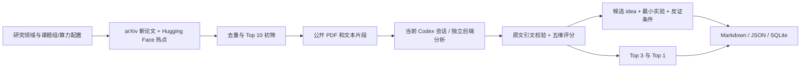

# Scholar Daily

在 Codex 中使用的个人文献调研 agent 技能。研究方向、课题组积累、数据和算力放在配置中；收集新论文和社区热点，分析创新/方法/结果/局限，再生成带最小实验与反证条件的 idea。

第一版提供命令行和 Markdown 报告。**不是已无人值守运行的服务**：定时文件已经可以生成，个人研究方向和资源预算需要先填写。

## 快速开始（Windows + Anaconda）

在 Codex 中打开完整项目目录，用 `$scholar-daily` 调用技能；入口为 `.agents/skills/scholar-daily/SKILL.md`，发现规则见 [OpenAI 官方技能文档](https://learn.chatgpt.com/docs/build-skills)。也可直接要求 Codex 读取根目录 `SKILL.md` 执行。需要本机已安装 Anaconda；启动脚本自动发现 Conda，在项目内创建 `.conda` Python 3.11 环境，安装项目和 Poppler。

```powershell
powershell -NoProfile -ExecutionPolicy Bypass -File .\scripts\scholar-daily.ps1 setup
```

按提示填写研究方向、英文检索式、arXiv 分类和精读上限。默认 `agent.backend=codex-session`，论文阅读、图表观察与 idea 生成由当前 Codex 会话完成，沿用用户所选模型和推理强度。例如会话选择 6.1 sol / high，就由该会话执行这些任务；项目配置不用填写模型 ID。已有 `config.json` 会保留，交互编辑前生成备份。`project.root` 默认 `.`（配置所在目录），所有项目相对路径均从这里解析。找不到 Conda 时可添加 `-CondaExe '本机 conda.exe 的完整路径'`。移动项目后重新创建 `.conda`，不要分享或搬运 Conda 环境本身。

会话模式使用 Codex 的登录与模型选择。选用 `harness` 后端时，安装 `pip install -e ".[harness]"`，并在本机设置 `DEEPSEEK_API_KEY`；可选 endpoint 使用 `DEEPSEEK_BASE_URL`。启动脚本按配置选择安装依赖。环境变量仅在当前会话设置时不会自动传递给以后的任务计划进程。

```powershell
.\scripts\scholar-daily.ps1 doctor
.\scripts\scholar-daily.ps1 demo       # 离线虚构演示
.\scripts\scholar-daily.ps1 collect    # 联网检索和初筛
.\scripts\scholar-daily.ps1 run        # 准备当前 Codex 会话的文件任务
.\scripts\scholar-daily.ps1 resume -Session '<run 返回的 session_path>' -NonInteractive
.\scripts\scholar-daily.ps1 history
.\scripts\scholar-daily.ps1 configure  # 再次编辑配置
```

在 agent/非交互终端加 `-NonInteractive`：环境创建和依赖安装照常进行，配置模板由用户或 agent 按真实信息填写。`doctor` 缺少必要配置时返回 1，并列出待填项；`local_ready` 表示本地条件就绪。Harness 的实际凭据和模型连接由 SDK 初始化验证。安装可重复运行；后续正常命令复用环境。

会话模式由 Codex 按技能自动完成 `run → 读取 prompt/schema → 写入 response.json → resume` 循环。`waiting` 表示等待当前会话处理待办，CLI 返回实际文件路径；格式、论文覆盖或 Evidence Record 引用不符合约束时，返回校验原因供会话修正。继续过程保留同一 run_id、论文材料与研究配置快照，支持中断后恢复；最终 `complete` / `partial` 才表示本次调研结束。等待期间保存阶段报告，最终报告生成后更新 `reports/latest.md`。

已有 Harness 配置时，可在命令中加 `-Backend codex-session` 临时使用当前会话。`codex-session` 每次调研重新分析，便于切换模型调试；它沿用当前处理任务的会话设置，不锁定起始模型。独立 `codex` 后端仍通过 `codex exec` 使用 CLI 自身的模型配置。

手动创建环境也可在项目根运行 `conda env create --prefix .conda -f environment.yml`，再使用上述启动脚本。PDF 文本提取使用 Poppler 的 `pdftotext`；启动脚本为当前进程补充环境 PATH，缺失或下载失败时明确降级为摘要发现线索。

## 个人配置

`research_profile.domains` 可以配置多个领域，每个领域包含英文 query 列表、arXiv 分类、新论文窗口 `recent_days`（默认 7 天）和热点论文年龄上限 `hot_days`（90 天）。普通 query 按精确短语检索；需要更宽检索时写 `all:streaming AND all:perception` 这样的显式 arXiv 查询。滑动窗口能覆盖周末、发布延迟和短暂失败。

`lab_context` 保存已有方法、数据集名称、论文、代码仓库和当前问题。第一版将这些当作你提供的背景，不会自动读取整个代码库。数据集用字符串名称，和 idea 的 `required_data` 对照。

`compute.gpus` 示例：`[{"model":"RTX 4090","count":1,"available_vram_gb":20}]`。填可分配的单卡显存，不是集群总显存；`max_experiment_hours` 是可接受的最小实验 GPU 小时。未知字段填 null/空列表，工具将建议标成 `needs_info`。

`sources.analysis_limit` 默认 10：分析 Top 10 候选，再按有证据的五维质量评分筛 Top 3 和 Top 1。可以调成 3 以控制用量，此时其余候选没有完整评估；报告显式标注。候选分析每批 3 篇，重点论文再生成设计讲解并接受独立语义核查，最后准备 idea；实际用量由所用账号和运行器决定。独立后端可复用分析缓存。最多 3 个 idea，也允许 0 个。

每次报告包含 `report.md`（逐篇创新、流程、模块输入/处理/输出、设计理由、实验与局限）、`evidence.md`（完整引文及定位）、`run-details.md`（检索、评分、用量及审查记录）和 `paper-explanations.json`（关联 Evidence Record 的结构化讲解）。完整调研中，每个方向最多保留 `sources.analysis_limit` 篇论文（默认10篇），全部逐篇生成完整讲解；前3篇表示阅读优先级。正文采用分级标题和短编号，原文引文放入证据附件；`latest.md` 的附件链接指向实际运行目录。已有分析仍可按证据类别展示。

默认每篇阅读上限为80,000字符，保留参考文献之后的附录；超出上限时优先选择方法、实验及审查反馈所指内容。启用视觉后，默认从整份PDF中选择最多12页方法图、公式和实验表，保留实际页码。每篇执行证据审查与最终讲解审查；结构缺项、错引或结论范围不符会触发补读和修复，最多3轮。缺少正文或修复后仍有缺口时，报告标为部分完成，逐篇列出原因，只有通过审查的内容进入正文及后续idea生成。`collect` 仍只输出候选线索。

长论文优先按研究动机、方法、实验与消融分配阅读预算。每日重点论文的讲解缺少必要内容时，最多进行一轮基于冻结本地正文的定向补读；仍有缺口则交付部分报告。动态研究任务通过 Quality Gate 将具体模块和阅读主题返回 Planner，沿用任务步骤及 Token 预算。作者设计理由和分析推断分别标明；讲解及断言通过语义核查后才进入正文和下游研究。语义核查是模型诊断，仍需要人工复核。

## 流程与边界



- **热点**：来自 Hugging Face trending 和 upvotes，保存信号与抓取时间。不是引用数，不冒充整个学科的热点；偏向 AI 社区。暂未接入 Semantic Scholar/OpenAlex 引用增长或会议网站。
- **证据**：只读到摘要时，不允许生成已验证贡献或方法/实验/创新评分。对取得的正文片段，每条贡献/结论需要一段原文连续引文；程序核对引文存在性。PDF 图表、附录和未发送片段不自动视为读过。
- **Idea**：必须引用本次已校验的 Evidence Record；输出机制、最近工作差异、查重新颖性的检索式、对照实验、指标、停止条件和资源估算依据。新颖性尚未自动完成独立文献查重，不应当作可直接投稿的结论。
- **长期记录**：按 arXiv 基础 ID 去重，保留版本日期；分析缓存绑定文本、研究背景和 backend 配置。Idea 带最近 30 条历史上下文并做标题去重；语义查重仍依赖模型，尚无向量库。
- **运行可靠性**：同一数据目录使用进程文件锁；超时和失败记录到数据库与报告；报告原子写入。部分来源/分析失败仍交付可用部分，进程返回码为 2；配置/致命失败返回 1，完整成功返回 0。不会自动对失败模型调用重试而增加花费。
- **Token 消耗**：`codex-session` 的用量以 Codex 显示为准，项目未取得会话 usage 时保留空记录。独立后端若提供 usage，`run-details.md` 与 `report.json` 按角色和模型记录调用次数、输入、缓存读、输出、推理和合计 token；未返回用量的调用不计入。
- **解析与时间**：会话模式要求完整 JSON，格式错误时交回当前会话修正；独立后端会尽力修复缺尾部括号的 JSON。额外字段忽略；分析校验剔除无法逐字核对的引文并降级对应评分维度。报告时间使用 Asia/Shanghai；等待状态的 `finished_at` 为 null。
- **数据位置**：`data/research.sqlite3`、`cache/papers/`、`reports/<时间-run_id>/`。每次保留 profile 快照、模型输入、原始结果、校验后的结果和 Markdown；`reports/latest.md` 是最近一次报告。
- **覆盖限制**：每个 query 抓取上限由 max_results_per_query 控制，Hugging Face 取前 100 条 trending；第一版没有全量分页或完整学科覆盖保证。PDF 长文本优先按章节选择片段，标题无法识别时按位置取样，保留完整本地提取文件，正式研究仍需精读原文图表和附录。
- **模型输入**：会把配置中的课题组背景、算力条件和选定的论文片段发给所选 backend。只填写你愿意用于此调研的背景。代码不读取其他项目和认证文件，也不发送邮件或消息。

## 每天北京时间 08:00

独立系统定时任务使用 `agent.backend=codex` 或 `harness`。`codex-session` 需要活跃的 Codex 会话，`schedule` 会提示选择独立后端。

### Windows 任务计划程序

```powershell
.\scripts\scholar-daily.ps1 schedule -NonInteractive
# 填好配置并成功执行一次 run 后，按需导入（任务名来自 project.name）：
Register-ScheduledTask -TaskName 'scholar-daily-my-research' -Xml (Get-Content -Raw .\deploy\scholar-daily-my-research.xml)
```

生成的 XML 使用带 `+08:00` 的每日触发时间和当前环境的绝对解释器路径；配套 PowerShell 脚本设置 Poppler PATH，日志在 `deploy/`。任务采用当前用户已登录会话，错过执行时允许补一次，并阻止并发实例。机器需要开机且可联网；任务进程需能取得该用户的凭据。项目移动或环境重建后重新生成任务文件。`schedule` 只写文件，导入时才创建任务。

### Linux systemd user timer

```bash
python -m scholar_daily schedule --config config.json --output deploy
mkdir -p ~/.config/systemd/user
cp deploy/scholar-daily-my-research.service deploy/scholar-daily-my-research.timer ~/.config/systemd/user/
systemctl --user daemon-reload
systemctl --user enable --now scholar-daily-my-research.timer
systemctl --user list-timers scholar-daily-my-research.timer
```

unit 名称来自 `project.name`；修改配置名时替换示例文件名。生成器固定 Anaconda 解释器绝对路径和 Codex PATH，显式使用 Asia/Shanghai。`Persistent=true` 会在错过时补执行一次，不会补跑每个漏掉的日期。开机后无人登录也要运行时，需管理员按实际环境启用 user lingering，或使用系统级服务。机器必须开机且可联网；单次先成功执行 `run` 再启用 timer。Codex 登录或 Harness 凭据需在该服务用户环境可用。

日志：`journalctl --user -u scholar-daily-my-research.service`。停止：`systemctl --user disable --now scholar-daily-my-research.timer`。

> **Windows**：文件锁使用 `msvcrt`，进程终止使用 `terminate/kill`。`schedule` 按当前系统生成对应任务文件。

## DeepSeek Harness 后端

`HarnessBackend`（`scholar_daily/agents.py`）已对齐官方 [Python SDK](https://github.com/deepseek-ai/DeepSeek-Harness/blob/master/python/sdk/README.md)（`deepseek-harness-sdk`，当前 0.1.5rc1）的 `DeepSeekHarness.run()` 接口：一次 pipeline 复用同一个 runtime 子进程，每个批次使用独立 session，正确处理 `finish_reason`（`completed` / `max-tokens` / `error` / `None`）。

在独立环境安装 SDK（要求 **Python ≥ 3.10**，会连带安装同版本 `deepseek-harness-runtime-bin`）：

```bash
python -m pip install -e ".[harness]"
# 在本机设置 DEEPSEEK_API_KEY；可选 endpoint 使用 DEEPSEEK_BASE_URL
```

Harness 配置示例（`model` 必须填该 provider 实际支持的模型 ID）：

```json
{
  "agent": {
    "backend": "harness",
    "timeout_seconds": 900,
    "harness": {
      "dsh_home": ".harness-home",
      "provider": "deepseek-official",
      "model": "填写该 provider 实际支持的 model ID",
      "reasoning_model": null,
      "profile": "",
      "reasoning_effort": null,
      "max_tokens": null,
      "initialize_timeout_seconds": null
    },
    "vision": {
      "enabled": false,
      "provider": "deepseek-official",
      "model": "该 provider 实际支持的视觉 model ID（如 deepseek-v4.1-flash）",
      "base_url": "",
      "max_pages": 6
    }
  }
}
```

- `dsh_home` 是独立 home（SDK 不会自动发现 `~/.dsh`），相对路径以 `project.root` 为基准；留空时读取 `DSH_HOME`。
- `model` 用于论文阅读/分析（摘要归纳 + 五维证据抽取），`reasoning_model` 用于 idea 生成等更吃推理的环节；`reasoning_model` 留空时全部环节都用 `model`。典型组合：`model=deepseek-flash`、`reasoning_model=deepseek-v4-pro`。两次调用各用一个 backend 实例，token 消耗按模型分别记录。
- `profile` 默认 SDK 的 `sdk` profile；`sdk-minimal` 是更精简的显式组合。`reasoning_effort` / `max_tokens` / `initialize_timeout_seconds` 可选。
- `python -m scholar_daily doctor` 会检查 SDK 是否可导入、`dsh_home`、`model` 与 `pdftotext` 是否就绪。
- 全文提取用 `pdftotext -layout` 取正文（证据源），并用 `pdfplumber` 抽取结构化表格文本并入正文，可参与逐字引文校验。图（位图）无法作为文本证据：启用 `agent.vision` 后，用 Poppler `pdftoppm` 渲染前 `max_pages` 页为 PNG，交给视觉模型输出图注，作为「独立视觉来源」注入分析上下文，但**不参与** `anchor_quote` 逐字校验。官方 DeepSeek API 仅提供文本模型（`deepseek-v4-pro` / `deepseek-flash`），视觉需另配支持图像的 provider/model（如 OpenRouter 的 `deepseek-v4.1-flash`），并用 `agent.vision.base_url` 与 `VISION_API_KEY` 指定其端点与凭据。

Harness SDK 仍为 developer preview，接口可能变化；`HarnessBackend` 是 Harness 调用层，核心的 JSON Schema、SQLite、报告和调度不依赖任何具体模型。其他国产 agent 只需实现 `run(prompt, schema, folder) -> dict`。

### 在 DeepSeek Harness GUI 内直接触发（技能入口）

项目根的 `SKILL.md` 是完整技能说明，DSH 发现入口 `.dsh/skills/scholar-daily/SKILL.md` 引用它。在 Harness 打开该工作区后，可直接用自然语言要求「收集今天的论文」「跑一次每日调研」「看历史报告」等；agent 会加载技能并按其中的命令与证据门槛驱动上面的 CLI，不会重写检索/评分/校验逻辑。技能发现路径遵循 DSH 约定（`<项目根>/.dsh/skills/<name>/SKILL.md`）。

## 分享

在项目根执行 `.conda\python.exe scripts/package_skill.py`，生成 `dist/scholar-daily-windows.zip`。分享完整 ZIP；接收者解压后按快速开始初始化。打包白名单包含技能、Python 包、脚本、配置模板、文档和测试。个人配置、密钥、Harness home、Conda 环境、论文和历史报告留在本机。

后续功能和验收范围见 [TODO.md](TODO.md)。当前分析使用 PDF 文本片段；会话模式可直接观察所准备的页图，独立 Harness 后端可配置视觉模型。

## 动态研究任务

通用动态研究任务已提供独立的 `research / research-resume / research-status` 入口，支持 LangGraph 规划、独立 Verifier、程序 Quality Gate、任务状态、预算与恢复。证据和研究产物通过审查后用于后续任务；质量反馈可触发补读、检索、修复或信息补充。安装和学习说明见 [Research Orchestrator](docs/research-orchestrator.md)。

动态研究任务支持论文／章节／片段索引、带页码和字符偏移的证据定位、三类支持性结果、人工抽样核验及 `memory.json` 恢复记录。输入用量与压缩质量配对比较的运行方式见 [Context Engineering](docs/context-engineering.md)。

项目同时提供 MCP Server/Client：可通过标准协议暴露 `search_papers`、`read_paper`、`verify_citation`、`query_history`，并由主 Agent 发现和调用外部 Zotero MCP 工具。配置、协议映射、Zotero 本地附件边界和测试见 [MCP 文献工具](docs/mcp.md)。

## 可复用 Agent Skills

高频研究任务提供四个独立技能：`paper-screening`、`evidence-verification`、`method-comparison`、`experiment-design`。每个技能包含 `SKILL.md`、运行脚本、JSON 输入输出契约及虚构样例，可通过项目 `.agents/skills/` 入口发现；正文和资源按需加载。独立脚本支持 `prepare / run / resume / status`，编排器支持 `--skill` 预加载及 `load_skill / load_skill_resource` 路由。调用、版本和分享说明见 [Agent Skills](docs/agent-skills.md)。

```powershell
.\.conda\python.exe -X utf8 -m scholar_daily skill-list
.\.conda\python.exe -X utf8 skills/paper-screening/scripts/run.py run --input skills/paper-screening/assets/example.json
```

## QASPER 公共基础评测

在项目 Conda 环境（Python 3.11+）中下载 [QASPER v0.3](https://huggingface.co/datasets/allenai/qasper)，创建固定文本子集，并运行给定论文内的 BM25 Top-5 + 问答基线：

```powershell
.\.conda\python.exe -X utf8 scripts/download_qasper.py --destination E:\datasets\qasper
.\.conda\python.exe -X utf8 -m scholar_daily.benchmark prepare --data-dir E:\datasets\qasper --output reports\qasper-baseline --count 50 --seed 20261012 --top-k 5
.\.conda\python.exe -X utf8 -m scholar_daily.benchmark run --output reports\qasper-baseline --backend harness --config config.json
.\.conda\python.exe -X utf8 -m scholar_daily.benchmark score --output reports\qasper-baseline
```

`run` 使用已有 Harness 配置及 `DEEPSEEK_API_KEY`，会产生真实模型调用；也支持 `--backend codex`。每批默认 5 题，开发集与留出集各 50 题。可先加 `--splits dev` 运行开发集，配置冻结后用 `--splits test` 运行留出集。已有批次结果自动复用，修改模型、提示词或运行器时应创建新的输出目录。整批失败时停止，保留失败与未运行数量；存在失败或未运行题目时返回码为 2。

`manifest.json` 保存数据指纹、抽样规则、样本 ID、过滤数量及检索指标；`run-config.json` 保存实际调用配置；每批保存输入、响应、事件、耗时与可获得的用量。`report.md`、`metrics.json` 和各划分的 `predictions.jsonl` 为评测输出。答案及证据使用下载包内、经指纹核对的官方评分脚本，多参考取最高分，失败预测按零分计入总体。测试集结果用于冻结配置的评测，不用于调参。

首版只保留所有参考标注均为文本、且可回答参考的证据能精确映射到正文的题目；每篇最多抽一题，原始开发/测试划分保持分离，并检查规范化问题的完全重复。近似问题未做语义去重。结果是筛选后子集的基础问答与证据选择表现；跨论文比较、动态补检索和结论支持率需独立评测。数据许可为 CC BY 4.0，原始数据包附下载来源及 SHA-256 清单。

开发集改进使用 `variant` 复用已有快照的题目 ID、顺序和原文，不重新抽样；默认仅生成 dev。`sweep` 离线比较 Top-5/10/20 与同章节前后各一段的补充策略，记录实际段数和字符数：

```powershell
.\.conda\python.exe -X utf8 -m scholar_daily.benchmark sweep --source reports\qasper-baseline --output reports\qasper-dev-study
.\.conda\python.exe -X utf8 -m scholar_daily.benchmark variant --source reports\qasper-baseline --output reports\qasper-dev-study\oracle --context oracle
.\.conda\python.exe -X utf8 -m scholar_daily.benchmark variant --source reports\qasper-baseline --output reports\qasper-dev-study\k5-n0 --top-k 5
.\.conda\python.exe -X utf8 -m scholar_daily.benchmark variant --source reports\qasper-baseline --output reports\qasper-dev-study\k20-n1 --top-k 20 --neighbors 1
.\.conda\python.exe -X utf8 -m scholar_daily.benchmark variant --source reports\qasper-baseline --output reports\qasper-dev-study\k10-n1 --top-k 10 --neighbors 1
.\.conda\python.exe -X utf8 -m scholar_daily.benchmark run --output reports\qasper-dev-study\oracle --backend codex --splits dev
.\.conda\python.exe -X utf8 -m scholar_daily.benchmark run --output reports\qasper-dev-study\k5-n0 --backend codex --splits dev
.\.conda\python.exe -X utf8 -m scholar_daily.benchmark run --output reports\qasper-dev-study\k20-n1 --backend codex --splits dev
.\.conda\python.exe -X utf8 -m scholar_daily.benchmark run --output reports\qasper-dev-study\k10-n1 --backend codex --splits dev
```

新回答将短答案放入 `answer`，支持解释放入 `explanation`；官方 Answer F1 仅评分 `answer`。`metrics.json` 另列字符规范化诊断：对预测和参考同时做 Unicode NFKC、弯引号/破折号映射及不可见分隔符清理，再调用原始官方 token F1。诊断保留数字、单位和原始答案，不替代官方分数，也不是语义正确率。各划分的 `diagnostics.json` 保存逐题两种分数、参考答案、解释、上下文长度和完整证据覆盖情况；缺失预测仍记零分。旧结果可重新评分，但不会自动拆分旧答案中的解释。

Oracle 提供所有可回答标注的证据并集，按正文排序，不提供参考答案；混合可回答性题保留并单列。全体不可回答题的空上下文会泄露可回答性，分析时应同时看 `diagnostics.groups.unanimous_answerable`。Oracle 与真实检索的上下文噪声不同，分差仅用于定位瓶颈。回答格式变化需以相同检索重新运行 Top-5 控制组，检索设置的选择结合官方回答 F1、证据覆盖和实际模型用量；仅在开发集选择后冻结设置。

如需验证候选池过长的影响，可让同一后端按问题相关性重排候选段落，固定保留 10 段，然后使用相同回答流程。重排输入只包含问题与候选原文，批次另存于 `retrieval-stage/`，标注仅用于完成重排后的离线评分：

```powershell
.\.conda\python.exe -X utf8 -m scholar_daily.benchmark_rerank --source reports\qasper-dev-study\k20-n1 --output reports\qasper-dev-study\rerank-k10 --keep 10
.\.conda\python.exe -X utf8 -m scholar_daily.benchmark run --output reports\qasper-dev-study\rerank-k10 --backend codex --splits dev
.\.conda\python.exe -X utf8 -m scholar_daily.benchmark_compare --runs reports\qasper-dev-study\k5-n0 reports\qasper-dev-study\oracle reports\qasper-dev-study\rerank-k10 --output reports\qasper-dev-study\comparison
```

`benchmark_compare` 对各运行只读，核对同一 dev 标注快照与题目顺序，第一项为配对参照；输出逐题诊断、配对 bootstrap 区间和分阶段用量。重排成本包含重排与回答两次调用。区间描述固定样本的不确定性，未涵盖模型重跑波动或多配置选择偏差。

Codex 首次遍历完成后，可运行 `python -m scholar_daily.benchmark_retry --output <运行目录>`，对整批无有效答案且属于 ID/证据格式错误的批次统一重试一次；含有效答案的批次保持原结果。`attempts/`、`first-pass-metrics.json` 保留原响应和首次分数，比较报告单列首次与最终结果，并累计额外用量。再次执行时已重试批次不会重复请求。

### 五组对照与完整评测指标

`benchmark_agent init` 默认创建 `five-arm` 策略，依次运行下面五组。使用新的实验目录，避免覆盖既有结果。

| 条件 | 输入与行为 | 配对比较目的 |
|---|---|---|
| `llm` | 标题、问题；使用模型已有知识，引用为空 | 建立直接回答基线 |
| `rag` | BM25 Top-5 后回答 | 对 `llm` 测量检索增强收益 |
| `rerank` | BM25 Top-20，由相同模型重排保留 5 段后回答 | 对 `rag` 测量重排收益 |
| `dynamic` | 相同初检与重排流程，回答后自主规划搜索、邻段补读或停止 | 对 `rerank` 测量主动补检索收益 |
| `verified` | 相同初检与重排流程，增加在线证据审查、已有上下文修复和审查失败后的拒答 | 对 `dynamic` 测量证据质量控制收益 |

五组独立推理，使用相同模型配置与问题顺序。动态组只接收自己的答案与检索历史；最终自动支持诊断在推理结束后执行。完整组的质量控制包含审查、修复、基于审查反馈的规划和拒答，配对差值衡量这组措施的整体收益。重排和生成均具有模型随机性，单次配对区间不涵盖重跑波动。

```powershell
.\.conda\python.exe -X utf8 -m scholar_daily.benchmark_holdout --prepare-dev --study reports\qasper-five-arm --dev-source reports\qasper-baseline
.\.conda\python.exe -X utf8 -m scholar_daily.benchmark_agent init --study reports\qasper-five-arm --model-config reports\qasper-dev-improvements-20261012\selected-config.json
foreach ($arm in 'llm','rag','rerank','dynamic','verified') {
    .\.conda\python.exe -X utf8 -m scholar_daily.benchmark_agent run --study reports\qasper-five-arm --split dev --arm $arm
    if ($LASTEXITCODE -ne 0) { throw "开发集运行失败：$arm" }
}
.\.conda\python.exe -X utf8 -m scholar_daily.benchmark_agent_report --study reports\qasper-five-arm --split dev
.\.conda\python.exe -X utf8 -m scholar_daily.benchmark_agent freeze --study reports\qasper-five-arm
.\.conda\python.exe -X utf8 -m scholar_daily.benchmark_holdout --study reports\qasper-five-arm --exclude-root reports --count 50 --seed 2026101901
foreach ($arm in 'llm','rag','rerank','dynamic','verified') {
    .\.conda\python.exe -X utf8 -m scholar_daily.benchmark_agent run --study reports\qasper-five-arm --split holdout --arm $arm
    if ($LASTEXITCODE -ne 0) { throw "验收集运行失败：$arm" }
}
.\.conda\python.exe -X utf8 -m scholar_daily.benchmark_agent_report --study reports\qasper-five-arm --split holdout
```

`--model-config` 读取含 `model_configuration` 的已有选型文件，五组继承其中的 backend、模型和推理配置。默认每批 1 题、最多 2 轮回答、每题最多 1 轮修复、每批最多 24 次模型尝试（包括失败重试及最终评测审查）。需要调整时在开发集首次运行前编辑 `policy.json`；更改已运行的策略或代码应使用新的实验目录。冻结与新验收集的隔离规则和下面的旧实验模式相同。

| 维度 | 新增输出与口径 |
|---|---|
| 检索质量 | 初检候选、首次回答上下文、最终上下文分别计算 Recall@K、MRR@K、二值 nDCG@K，默认 K=1/5/10/20。仅纳入有非空参考证据的题目，每项指标取最佳参考后按题平均；段落原文去重，最终上下文按补入顺序排列，K 超过实际列表长度时按实际内容评分。直接组不适用。 |
| 回答质量 | 官方 Answer F1；额外计算采用官方答案规范化的 Exact Match，多参考取最大值。 |
| 证据质量 | 官方 Evidence F1；Evidence Precision/Recall 同取证据 F1 最大的参考集，再按 Recall、Precision、标注顺序处理平局。预测和参考都为空时均为 1；失败或未完成题记 0。另输出人工核验支持率与覆盖率。 |
| Agent 能力 | 严格任务成功率：规范化答案与证据集合同时匹配同一参考。任务修复率：初始未成功但最终成功的题数/已产生初始答案且初始未成功的题数。另记录失败调用重试恢复率、在线及全链路平均模型尝试次数。零分母记未知。 |
| 性能与成本 | 累计实测运行延迟、批次累计时间、平均/P95 逐题推理延迟、完整 token 账本、单题在线费用和最终评测审查费用。逐题延迟取同步批次推理完成时间，最终审查单独计时，P95 使用最近秩法；批量、并行及恢复缓存的解释见报告。 |

每组的 `runs/<split>/<arm>/human-support-packets.json` 提供问题、答案和引用原文；在同目录 `human-support.json` 中填写 `reviewer`、`reason`，并把 `verdict` 从 `pending` 改为 `supported`、`unsupported` 或 `uncertain`。核验的是答案全部事实与必要限定是否被所引段落支持；`uncertain` 计入已核验分母，`pending` 留待核验。随后重新运行该组的 `benchmark_agent score`，再生成比较报告。核验表用指纹绑定答案与引用；部分核验的支持率须同时报告覆盖率。开发集核验应在冻结前完成，冻结后其产物受指纹保护。自动审查分数和人工支持率分别保存。

货币费用默认未知。如需计算，在首次运行前给 `policy.json` 增加明确币种与单价，例如下面的**示例配置（并非任何服务的实际报价）**：

```json
"pricing": {
  "currency": "CNY",
  "input_per_million": 1.0,
  "cached_input_per_million": 0.1,
  "output_per_million": 2.0
}
```

计价区分输入、缓存输入和输出；Codex 输入 token 包含缓存，Harness 的 `inputTokens` 是未缓存输入。任一调用缺少输入/输出用量时，该部分费用记未知，已记录 token 为下界。在线费用包含重排、回答、规划、修复、在线审查及失败尝试；最终评测审查费用单列，实验实际总费用包含全部实际调用。`metrics.json` 保存逐组指标，`comparisons/<split>/comparison.json` 与 `report.md` 保存四项相邻组配对差值及完整指标。官方 F1 仍由固定 SHA-256 的 [QASPER 官方评分器](https://github.com/allenai/qasper-led-baseline/blob/main/scripts/evaluator.py)计算并以命令行复核；Exact Match、排序指标、严格任务成功率及人工核验为本项目补充口径。

### 有界动态 Agent 与新验收集（legacy 模式）

四个条件依次为 `rag20`（Top-20）、`rag20_gate`（Top-20＋审查拒答）、`rag20_repair`（Top-20＋修复）、`agent`（完整动态 Agent）。后续条件复用 Top-20 的初始答案，修复组和动态组还复用审查组的第一次在线审查；动态组复用修复组在初始上下文中的修复及重审。各条件的最终支持审查分别调用模型。

```powershell
.\.conda\python.exe -X utf8 -m scholar_daily.benchmark_holdout --prepare-dev --study reports\qasper-agent --dev-source reports\qasper-v0.3-codex-20261012
.\.conda\python.exe -X utf8 -m scholar_daily.benchmark_agent init --study reports\qasper-agent --model-config reports\qasper-dev-improvements-20261012\selected-config.json --suite legacy
foreach ($arm in 'rag20','rag20_gate','rag20_repair','agent') {
    .\.conda\python.exe -X utf8 -m scholar_daily.benchmark_agent run --study reports\qasper-agent --split dev --arm $arm
    if ($LASTEXITCODE -ne 0) { throw "开发集运行失败：$arm" }
}
.\.conda\python.exe -X utf8 -m scholar_daily.benchmark_agent_report --study reports\qasper-agent --split dev
.\.conda\python.exe -X utf8 -m scholar_daily.benchmark_agent freeze --study reports\qasper-agent
.\.conda\python.exe -X utf8 -m scholar_daily.benchmark_holdout --study reports\qasper-agent --exclude-root reports --count 50 --seed 2026101301
foreach ($arm in 'rag20','rag20_gate','rag20_repair','agent') {
    .\.conda\python.exe -X utf8 -m scholar_daily.benchmark_agent run --study reports\qasper-agent --split holdout --arm $arm
    if ($LASTEXITCODE -ne 0) { throw "验收集运行失败：$arm" }
}
.\.conda\python.exe -X utf8 -m scholar_daily.benchmark_agent_report --study reports\qasper-agent --split holdout
```

开发集按官方 Answer F1 选定条件，平分时依次优先完整链路调用较少的条件和预设条件顺序；完成四组运行及官方命令行复核后冻结模型配置、提示、代码和开发集结果指纹。新题在冻结后预留，按已有 `reports/**/gold.json` 排除论文 ID、规范化标题、相同正文，以及重复或高度近似的问题，涵盖过去的开发集与验收集。`holdout-seal.json` 将新题快照绑定到冻结记录；冻结后开发集推理关闭。每次更改策略使用新实验目录。

Agent 从 Top-20 起步，默认最多两轮回答、每题最多一轮修复、每批最多 16 次模型尝试（包含失败重试及最终审查）。支持检查未通过时，先用已有段落补齐引用或删除无依据的附加事实，保留问题必需的数值、单位、否定和范围条件；修复后独立重审。动态组仍缺证据时，规划查询改写或同章节邻段补读，每次最多补入 5 段，累计上限 30 段与 24,000 字符。预算内仍未通过则拒答。

逐题保存初始候选答案、修复前后答案及段落引用、修复前后审查、查询、补入段落及停止原因。连续引文须匹配原文（只规范化空白）；语法连接词 `by`、`with`、`including` 可位于原子断言之间，关键事实和限定条件仍须覆盖。语义支持由同模型审查，属于自动诊断；拒答单列，受支持回答须为最终审查通过的正面回答。

报告给出官方 Answer/Evidence F1、支持回答数及分母、拒答数，并分别比较审查、修复、补检索对 F1、拒答率、支持产出率和成本的影响。配对 bootstrap 区间使用同一批题目，重采样 2000 次。调用账本包含回答、规划、修复、在线审查、修复审查、最终审查及所有失败尝试；各组全链路开销包含复用的初始调用，实验实际成本对复用调用去重。用量缺失标为下界，缺少计价依据时货币费用记为未知。各组导出经官方评分器命令行复核。新题表示本地已记录流程未使用，预训练或未记录曝光未知。

## 验证

```bash
.conda\python.exe -m unittest discover -s tests -v
```

测试针对证据拒绝、资源约束、跨天复用、失败报告和定时配置。离线演示样本明确标为虚构，不作为真实调研结果。

## 来源

- [Claude Scholar](https://github.com/Galaxy-Dawn/claude-scholar/tree/codex)：借鉴 daily-paper-generator 的 Top 10 → Top 3 → Top 1 和 research-ideation 的证据/假设规则；本项目代码为独立实现。
- [arXiv API](https://info.arxiv.org/help/api/user-manual.html)：查询、元数据和公开论文链接。
- [Hugging Face HfApi.list_daily_papers](https://github.com/huggingface/huggingface_hub/blob/main/src/huggingface_hub/hf_api.py)：trending 查询与返回结构。
- [Codex 非交互运行](https://developers.openai.com/codex/noninteractive)：通过 codex exec 和 JSON Schema 执行批处理。
- [OpenAI 技能文档](https://learn.chatgpt.com/docs/build-skills)：`SKILL.md`、`.agents/skills` 发现路径与技能调用方式。
- [DeepSeek Harness SDK](https://github.com/deepseek-ai/DeepSeek-Harness/blob/master/python/sdk/README.md) 与 [runtime](https://github.com/deepseek-ai/DeepSeek-Harness/blob/master/python/sdk-runtime/README.md)：可选后端、独立 home、Windows runtime 和完成状态语义（核对日期：2026-10-08）。
- [Claude Scholar 检索脚本](https://github.com/Galaxy-Dawn/claude-scholar/blob/main/skills/daily-paper-generator/scripts/arxiv_search.py) 与 [研究证据约束](https://github.com/Galaxy-Dawn/claude-scholar/blob/main/skills/research-ideation/references/research-contract.md)：参考检索窗口、分层筛选和来源强度；保留本项目独立实现。
