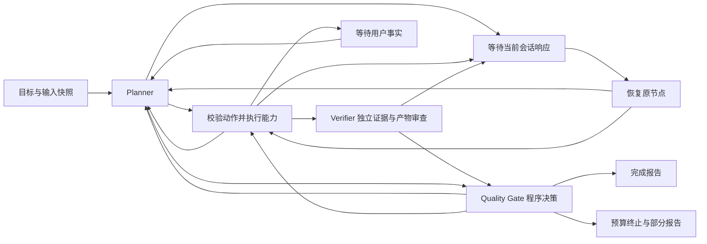

# Research Orchestrator

编排器接收自然语言研究目标，由 Planner 根据当前材料、证据、信息缺口和预算选择下一步能力。原有每日调研入口继续使用；编排任务使用独立的 `research` 入口与任务目录。

## 安装与运行

使用项目已有的 Anaconda 环境。当前验证版本为 LangGraph 1.2.15、SQLite checkpointer 3.1.2，依赖放在可选 extra 中。

```powershell
.\.conda\python.exe -m pip install -e ".[orchestrator]"
.\.conda\python.exe -X utf8 -m scholar_daily research --config config.json --backend codex-session --goal "查找最近一周有关轻量化目标检测的论文，对比创新点，分析哪些方法适合部署到 Jetson Orin，并设计一个可执行的实验方案。"
```

PowerShell 启动脚本也支持新入口，并自动安装所需 extra：

```powershell
.\scripts\scholar-daily.ps1 research -Backend codex-session -Goal '比较最近一周轻量化目标检测论文并设计部署实验' -NonInteractive
.\scripts\scholar-daily.ps1 research-status -TaskDir '<返回的 task_dir>' -NonInteractive
.\scripts\scholar-daily.ps1 research-resume -TaskDir '<返回的 task_dir>' -NonInteractive
```

每个新任务生成 UUID。恢复使用返回的 `task_dir`，并读取任务开始时保存的项目配置、目标和预算。`research-resume` 不要求当前 `config.json` 存在。使用相同代码和依赖版本恢复；修改策略或代码后创建新任务。

会话模式返回 `pending.kind=session` 时，当前会话读取 `pending.task.prompt_path` 和 `schema_path`，在 `response_path` 写入完整 JSON，再执行 `research-resume`。所有 Planner、论文分析、Verifier 审查、部署评估与实验设计响应都沿用这一交换机制。独立 `codex` 和 `harness` 后端通过已有 `run(prompt, schema, folder)` 接口调用。

`pending.kind=user` 表示缺少用户事实，报告列出问题及字段。例如 `deployment.device_variant` 表示设备的具体型号，`deployment.memory_gb` 表示此设备实际可分配的内存预算。编排器不会凭设备系列名填入规格。

把补充内容写入 JSON 文件：

```json
{
  "facts": {
    "deployment": {
      "device_variant": "填写实际设备型号",
      "memory_gb": null,
      "software_stack": "填写实际 JetPack/TensorRT 等版本",
      "power_mode": "填写实际功耗模式",
      "dataset": "填写已取得且可用于实验的数据及划分",
      "input_shape": "填写实际输入尺寸及 batch size",
      "target_latency_ms": null
    }
  },
  "unavailable": ["deployment.memory_gb", "deployment.target_latency_ms"]
}
```

`unavailable` 明确列出当前无法提供的字段；Planner 可以交付部分结果并保留缺口。需要补充训练资源时，使用 `facts.compute`；需要补充已拥有的数据时，使用 `facts.lab_context.datasets`，格式沿用项目配置。此类补充只用于当前任务。

```powershell
.\.conda\python.exe -X utf8 -m scholar_daily research-resume --task-dir '<task_dir>' --answer answer.json
```

也可在任务开始时使用 `--input <JSON文件>`。输入结构为 `{"facts": {...}, "papers": [...]}`；每篇论文使用 `scholar_daily.models.Paper` 字段，至少包含 `paper_id/source/title/authors/abstract/published/updated/url/pdf_url`，可携带 `full_text`。输入最多10篇，全文中的引文仍必须经过程序校验。已提供正文的论文可跳过网络检索及正文获取。

## 图与角色



一个 Planner 负责全局路由。`literature_analyst` 负责论文证据分析；`experiment_designer` 负责部署推断和实验设计；`verifier` 使用独立提示、输出契约及调用记录审查断言。Quality Gate 使用程序规则决定结果能否交付、是否需要补读/检索、修复或询问用户。各模块按序执行，通过共享任务状态协作。Harness 配置有 `reasoning_model` 时，规划、实验设计和审查使用该模型，论文分析使用 `model`；会话模式沿用当前会话设置。每一步工具、角色、参数、决策理由和失败信息均可查看。协作收益需要后续对照实验验证。

工具注册表位于 `research_tools.py`，新增能力时注册名称、职责、前置条件及执行函数即可；模型后端接口保持稳定。

| 能力 | 前置条件与输出 |
|---|---|
| `search_papers` | 英文 query、时间窗口；复用 arXiv、去重和相关性排序，任务论文上限10篇 |
| `read_papers` | 本任务论文 ID；复用 PDF 正文提取及本地缓存；query 非空时按主题匹配补读缓存全文，更新片段后重新分析 |
| `analyze_papers` | 本任务论文 ID；复用 `ANALYSIS_SCHEMA`、连续引文校验，产出 Evidence Record |
| `compare_methods` | 至少两篇有正文证据的论文；按创新、方法、结果、局限整理已有证据，不直接跨评测条件比较数值 |
| `assess_deployment` | 有正文证据，设备型号、可用内存、软件、功耗、数据、输入尺寸和延迟目标已提供；产出条件评估及上机验证步骤 |
| `design_experiment` | 有正文证据；部署任务先完成部署评估，复用 `IDEA_SCHEMA` 和资源校验 |
| `repair_result` | 有 Quality Gate 的问题记录；query 指定 analysis/comparison/deployment/experiment，保留必要事实及限定条件，修复后重新审查 |
| `ask_user` | 明确问题和 facts 字段；暂停并保存状态 |
| `finish` | 完整交付要求全部所需产物已经存在；证据或资源不足时保留部分报告 |

方法对比表目前整理已校验的贡献和结论。数据划分、硬件及评测协议的完整结构化提取仍是后续扩展；`comparability=needs_info` 表示尚未确认数值能直接比较。部署 `candidate` 表示值得上机验证，不表示已经完成算子适配、内存或延迟测试。程序验证引文和引用 ID，解释是否得到引文充分支持仍需人工审阅。

Planner 输入包含各模块的证据缺口、部署待确认条件及实验资源缺口。主题补读使用关键词匹配选取缓存全文中的最多5个文本块，保留正文顺序和省略标记；只读取 `cache/papers/` 下的正文文件。新片段会使该论文已有分析及下游产物失效，Planner 需要重新分析后再比较或设计实验。

## Verifier 与 Quality Gate

`research_verifier.py` 和 `quality_gate.py` 是两个独立模块，在 LangGraph 中分别对应 `verifier` 与 `quality_gate` 节点。审查路径由程序安排，Planner 不能省略审查后直接完成任务。

1. Reader 产出分析后，Verifier 检查逐条科学断言。程序先核对论文、Evidence ID 和连续引文；匹配只规范化空白，保留数字符号、单位及原始措辞。模型再判断引文是否支持断言的对象、数值、实验条件、范围、否定和因果强度。
2. Research 只接收审查通过的证据视图。失败记录仍保留在任务状态和审查历史中，评分维度随可用证据降级。摘要概述单独以摘要作为来源，不能提供全文证据。
3. 方法比较、部署评估和实验设计分别接受产物审查；部署评估需通过后才能用于部署实验设计。
4. `finish` 触发最终审查。Quality Gate 同时检查所需产物、实验资源和未确认的部署条件。通过后交付完整报告；发现缺口时返回 Planner；预算/重试耗尽或同一阶段累计失败达到审查轮数上限时部分交付。

Verifier 按每批最多8项生成独立审查请求。`VERIFICATION_SCHEMA` 中，每项保留完整文本、来源 ID、连续引文、断言 span、支持/部分支持/不支持/矛盾判断、限定条件判断及补充建议。程序核对审查是否覆盖全部实质文字；模型填写“已全部覆盖”不能绕过这一检查。显式的未来实验或条件假设可以标记 `not_factual`；其中的既有结果和资源事实仍需分别审查，事实类型不能获得此豁免。

Quality Gate 的决策为 `pass/read_more/retrieve_more/repair/needs_input/partial`，每个问题定位到产物字段，并附建议工具及参数。未知资源返回信息补充建议；已知预算不足返回重新设计建议。修复次数、调用尝试及 Token 预留均计入原预算。审查缓存绑定材料、用户事实和修复操作指纹；变更材料或事实会使旧审核失效，修复操作触发新的审查请求。审查阶段也支持会话响应修正与跨进程恢复。

报告的正文只展示通过审查的证据和产物；未审查或被拒绝的候选内容保存在 `state.json` 及模型回执中。报告另外展示审查问题、Quality Gate 决策和建议动作。

Verifier 的独立性体现在模块、提示、输出契约和调用记录。默认仍使用配置中的模型；会话模式仍由当前会话处理。语义支持判断属于模型诊断，可能存在共同偏差，不能视为人工评审或事实正确性的证明。

## 状态与恢复

`ResearchState` 是明确的 JSON 数据契约：

| 字段 | 含义 |
|---|---|
| `task_id/goal/status` | 任务标识、目标和生命周期 |
| `config/facts` | 项目配置快照与用户明确提供的任务事实 |
| `plan/deliverables/next_action` | 当前计划、所需产物和下一步操作；重规划不能静默缩减所需产物 |
| `papers/analyses/evidence/artifacts` | 本次材料、分析、已校验证据和最终产物 |
| `issues/pending` | 工具错误、待补信息及当前暂停原因 |
| `verification/review_request/review_history` | 当前审核结果、审核任务及完整审核历史 |
| `gate/gate_history` | 当前质量决策及历次反馈 |
| `steps/planner_round` | 工具执行轨迹与规划进度 |
| `limits/budget` | 步骤、尝试、模型调用和 Token 预算 |
| `context_policy/paper_contexts` | 本地上下文策略、原文快照索引与片段选择记录 |
| `context_metrics` | 按任务与角色累计的输入 Token 实测、估计及未知数量 |
| `external_tools/external_results` | MCP 工具目录、Function Calling 映射及外部结果回执 |

LangGraph 的 `StateGraph` 定义节点；`add_conditional_edges` 根据状态路由；`SqliteSaver` 持久化检查点；`interrupt()` 和 `Command(resume=...)` 对接会话响应及用户信息。任务 UUID 作为 LangGraph 的 `thread_id`，它与 Codex 聊天 ID 分开管理。执行使用 `durability="sync"`。

每个任务保存：

- `task.json`：初始目标、配置、输入、预算及代码/依赖指纹。
- `graph.sqlite3`：LangGraph 检查点及暂停位置。
- `calls.sqlite3`：模型调用尝试、预算预留、用量和工具尝试记录。
- `model-calls/`：冻结请求、各次模型响应与成功回执。
- `tool-calls/`：按输入指纹保存成功工具结果。
- `state.json/report.md`：可阅读的状态快照与原子写入的报告，等待期间也生成。
- `context/papers/`：可校验的原文与章节／片段索引；`memory.json` 保存结构化恢复记录。
- `audit-sample.json/human-audit/`：带原文的人工抽样任务及独立核验标签；使用说明见 [Context Engineering](context-engineering.md)。
- `tool-calls/`：外部 MCP 工具调用的输入指纹、结构化结果或错误回执；外部结果需重新经过项目证据审查。
- MCP Server/Client 使用说明见 [MCP](mcp.md)。

恢复时成功回执会被复用。中断发生在成功回执落盘以后、图检查点写入以前时，也可以复用结果。若独立供应商已处理请求但本地没有收到成功回执，恢复可能重新请求；已预留的失败/中断调用仍进入预算。工具限于检索、读取和本地结果写入，这些操作适合重复执行。每个任务有跨进程文件锁。

默认预算：最多20个工具步骤、30次模型尝试；同一模型请求或工具输入最多2次尝试（包含第一次），同一审查阶段累计失败最多3轮。未返回用量的调用至少按16,000 Token 预留；较长输入按 UTF-8 字节数加4,096预留。已知用量替换估计，未知用量不会当作零。默认总 Token 预算250,000，可通过 `--max-steps/--max-model-calls/--max-attempts/--token-budget/--max-review-rounds` 或 PowerShell 对应参数设置。Verifier 调用也计入这些预算，较多论文或反复修复时可能交付部分报告。

调用次数与尝试上限在调用前强制检查。Token 预算用于决定是否开始下一次调用：现有后端接口不提供统一、可验证的每次输出硬上限，实际用量可能超过预留值，因此不能宣称供应商 Token 或货币费用被严格限制。预算耗尽时停止新增模型调用并交付部分报告。

返回码：`0` 完整交付；`2` 等待会话、等待用户信息或部分交付；`1` 配置/致命错误。`research-status` 是检查命令，正常读取返回0。编排任务独立保存报告，不更新每日调研的 `latest.md`。

## 验收

```powershell
.\.conda\python.exe -X utf8 -m unittest discover -s tests -p test_orchestrator.py -v
.\.conda\python.exe -X utf8 -m unittest discover -s tests -p test_verifier.py -v
.\.conda\python.exe -X utf8 -m unittest discover -s tests -v
```

三个受控场景：

| 输入任务 | 预期路径 | 检查重点 |
|---|---|---|
| 只查最近一周轻量化检测论文列表 | 检索→完成 | 不调用正文阅读或分析 |
| 比较已提供正文的两篇论文创新点 | 分析→证据审查→比较→产物审查→最终审查→完成 | 不重复联网检索，比较项带 Evidence ID |
| 查找检测论文，比较并设计目标设备部署实验 | 检索→阅读→分析→证据审查→比较→补充设备事实→部署评估及审查→实验设计及审查→最终审查→完成/部分交付 | 事实不足暂停；补充后沿同一任务继续 |

自动测试使用明确标为虚构的论文夹具及受控 Planner/Verifier 响应，验证图路由、工具前置条件、状态传递和恢复行为。还覆盖未知来源、伪造/拼接引文、符号或单位变化、断言覆盖缺失、条件不受支持、假设类型豁免、修复后重新审查、通过证据的筛选、最终审查拒绝、预算耗尽，以及审查回执落盘后中断时避免重复调用。这些测试不衡量模型语义判断或自然语言 Planner 的准确率，也不证明多个专业角色优于单角色；这些结论需要固定任务和成本条件下的独立评测。

实现依据：[LangGraph Persistence](https://docs.langchain.com/oss/python/langgraph/persistence)、[LangGraph Interrupts](https://docs.langchain.com/oss/python/langgraph/interrupts)。
